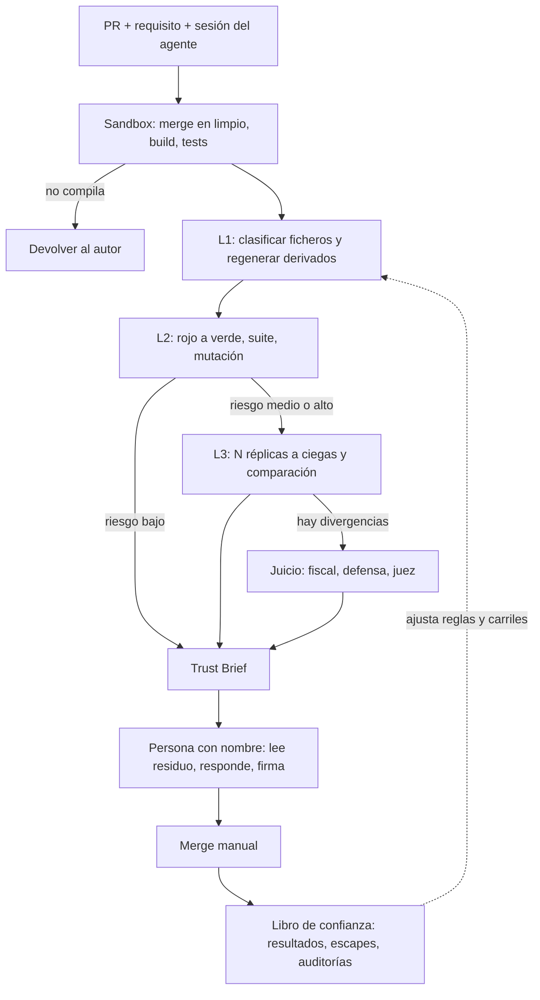

# Planning — Junction 2026

**Reto principal:** Tieto · *Earned Trust in AI Code* · **Reto lateral:** MLH · *Best Use of Entire*

> **Estado:** implementado. La aplicación está en este repo: ver [README.md](README.md) para arrancarla.
> Este documento es el plan original; lo que cambió al construirlo está en [concept/DECISIONS.md](concept/DECISIONS.md) y [concept/LESSONS.md](concept/LESSONS.md).
> **Nombre del proyecto:** Katse (identidad visual en `visual/`).
> **Mockup inicial de las pantallas:** https://claude.ai/artifact/6KaFVGBokZjbsyU8BdggZa (privado hasta que lo compartáis desde el menú Share). La interfaz real es distinta: es la de `mvp/`.

---

## 0. Resumen en un minuto

- **Qué pide Tieto.** Un *concepto* de revisión de código hecho por IA, demostrado sobre un cambio real escrito por un agente, en el que una persona con nombre y apellidos firma el cambio sin tener que leerlo entero. Puntúa más el concepto que el código.
- **Nuestra respuesta: «No lo leas, reprodúcelo».** Leer línea a línea no escala. Reproducir sí: un cambio escrito por un agente es barato de producir, así que también es barato volver a producirlo. Todo lo que una máquina consigue reproducir de forma independiente queda respaldado con evidencia ejecutable. Lo que no se puede reproducir es el **residuo**, y eso es lo único que la persona lee y firma.
- **Dónde encaja Entire.** Guarda el prompt y la sesión del agente enganchados al commit. Es el punto de partida para reproducir un cambio: sin saber qué se le pidió al agente, no se puede volver a derivar lo mismo.
- **Demo.** El PR real `ju26-issue-2283` como caso principal, `ju26-issue-2297` (237 ficheros) para enseñar escala y `ju26-issue-2234` para enseñar a la IA negándose a revisar.
- **Lo que verá el jurado.** Tres pantallas: bandeja de PRs enrutados por riesgo, el *Trust Brief* de un PR con la firma humana, y el libro de confianza con las métricas.

---

## 1. El reto, explicado

### 1.1 Qué piden

La pregunta del reto es: *¿cómo sigue el ritmo la revisión de código por IA al código escrito por IA, mientras las personas siguen siendo responsables de cada cambio?*

Piden cuatro cosas concretas:

1. **Un concepto**: qué proceso recomendamos que siga la «fábrica de revisión de PRs».
2. **Sus principios**, diciendo cómo equilibra riesgo, alucinación, transparencia, confianza y calidad.
3. **Una implementación de referencia** sobre un cambio de ejemplo escrito por un agente, con su ID de requisito. Tiene que enseñar qué encontró la IA, **qué se negó a decidir y por qué**, y cómo la evidencia permite que una persona con nombre acepte el cambio sin leerlo todo.
4. **Los modos de fallo que hayamos visto** y un registro corto de decisiones.

Solo se pueden usar datos sintéticos o de ejemplo.

### 1.2 Cómo puntúan y qué implica

| Criterio | Peso | Qué mira | Con qué lo ganamos |
|---|---|---|---|
| Claridad | 30 % | Recomendación clara, principios, trade-offs y límites | Concept card de una página y una frase que se recuerde |
| Practicidad | 25 % | Funciona en un flujo real de PR, escala, y una persona con nombre es dueña de cada decisión | El brief aparece dentro del PR; CODEOWNERS decide quién firma; coste por PR |
| Medición | 25 % | Cómo se mide la confianza | Libro de confianza + un experimento con número real (defectos sembrados) |
| Evidencia | 20 % | Evidencia trazable al requisito; qué encontró la IA y qué se negó a decidir | El Trust Brief del PR #2283 |

Consecuencia práctica: más de la mitad de la nota (Claridad + Medición) se gana con documentos y números, no con código. Hay que reservar a una persona para eso desde el principio.

### 1.3 Lo que dijeron en el stand

- El tema es la **confianza**, no la revisión. La persona conduce y decide.
- Contexto de **tolerancia cero**: software bancario donde un fallo mueve millones a la cuenta equivocada.
- La revisión línea a línea **ya no es posible**: los agentes generan miles de líneas por hora.
- Quieren una idea **fuera de la caja**, un cambio de paradigma. Pesa más la idea que la técnica.

### 1.4 Lo que no aceptan

- «La IA dijo que estaba bien.»
- Un merge sin dueño.
- Confianza sin evidencia, o una puntuación de riesgo que nadie sabe explicar.

Esto descarta de entrada cualquier diseño con «confianza 94 %» o con merge automático.

### 1.5 Entregables obligatorios

- [ ] Concept card: recomendación, principios, trade-offs, límites
- [ ] Walkthrough en vivo que enseñe de dónde sale la confianza
- [ ] Lessons log (modos de fallo vistos + registro de decisiones)
- [ ] Vídeo o presentación de demo

---

## 2. Lo que hay en el repo del reto (datos comprobados)

He bajado las cuatro ramas y leído los diffs y las issues. No he compilado ni ejecutado nada (en esta máquina no hay .NET).

| Rama | Requisito | Tamaño | Qué toca de verdad |
|---|---|---|---|
| `ju26-issue-2283` | #2283, bug: el generador y el analizador petan con `IndexOutOfRangeException` ante un struct genérico cerrado de un ensamblado referenciado | 4 ficheros, +225 / −3 | `TypeCollector.cs` (29 líneas), 3 tests nuevos (189), README (5), doc `MsgPack004` (5) |
| `ju26-issue-2234` | #2234, bug: «The analyzer does not work if SuppressSourceGeneration = true» | 4 ficheros, +262 / −4 | `TypeCollector.cs` (22 líneas), 2 ficheros de tests (230), README (14) |
| `ju26-issue-2129` | #2129, feature: generar un formatter para un tipo de un ensamblado referenciado | 28 ficheros, +1034 / −9 | Atributo público nuevo, 4 diagnósticos nuevos (`MsgPack019`–`022`), `GeneratedFormatterCollector.cs` nuevo (300 líneas), plantillas, proyecto de test nuevo |
| `ju26-issue-2297` | #2297, feature: añadir `[ExcludeFromCodeCoverage]` al código generado | 237 ficheros, +1383 / −9 | 6 plantillas `.tt` (27 líneas) y sus `.cs`, 222 snapshots de test, 1 test nuevo (130), README (3) |

Cuatro hallazgos que sostienen el concepto:

**#2297: 237 ficheros, pero el cambio real son 27 líneas.** De las 1.209 líneas añadidas en los 222 snapshots, 1.206 son el mismo bloque de tres líneas repetido 402 veces. Solo un snapshot tiene además un cambio distinto: un salto de línea nuevo antes de `internal sealed class HasPrivateSerializedMemberAndIsGenericNamedFormatter`. Leyendo a mano, esa anomalía se pierde entre 221 ficheros idénticos. Una máquina la aísla en segundos.

**#2283: el arreglo hace más de lo que pide la issue.** La issue pide que deje de petar. El agente, además, envuelve todos los diagnósticos en `ReportIfLocatedInCompilation`, que descarta cualquier diagnóstico cuya ubicación no esté en la compilación actual, y lo documenta como norma en el README («lo reporta el ensamblado que define el tipo»). Es una decisión de producto que el requisito no menciona. Si ese otro ensamblado no usa el analizador, nadie avisa del problema. Es justo el tipo de cosa que una IA no debería decidir sola. Dato a favor del arreglo: de los 3 accesos `DeclaringSyntaxReferences[0]` que había en el fichero, tras el cambio queda 1 y está en una línea comentada.

**#2234: el requisito es una frase.** La issue dice que el analizador «no funciona» y que en 3.1.0 funcionaba. El arreglo salta miembros con claves mezcladas e ignora claves duplicadas, algo que no se deduce de esa frase. Además repite el mismo guard `ContainsKey` en cuatro sitios. No se puede revisar un cambio contra un requisito que no dice qué es correcto.

**#2129: superficie pública nueva.** Atributo nuevo y cuatro IDs de diagnóstico. Aquí no hay atajo: una persona tiene que leer el diseño de la API.

Sin haberlo buscado, los cuatro PRs de Tieto caen cada uno en un carril distinto de nuestro enrutado (apartado 3.4). Eso hace la demo mucho más fácil de contar.

---

## 3. El concepto

### 3.1 La idea

En ciencia nadie se fía de un resultado por leer el artículo con atención. Se fía cuando otro laboratorio lo reproduce. En banca nadie relee cada apunte: se concilian dos registros independientes y se investiga solo lo que no cuadra.

Katse aplica eso al código. En vez de leer el diff, intenta reproducir el cambio por tres vías independientes. Donde las vías coinciden hay evidencia. Donde no, hay una pregunta para una persona.

Para el pitch ante Tieto, la analogía bancaria es la que mejor entra: **partida doble para el código**. Cada cambio se «asienta» dos veces de forma independiente, los libros tienen que cuadrar y una persona firma los descuadres.

### 3.2 Tres niveles de reproducción

| Nivel | Qué se reproduce | Cómo | Qué demuestra | Ejemplo |
|---|---|---|---|---|
| **L1 · Determinista** | Ficheros derivados: código generado, snapshots, formateo | Regenerarlos desde su fuente y comparar; detectar el mismo cambio repetido | Que N ficheros son consecuencia mecánica de M líneas | #2297: 222 snapshots salen de 6 plantillas |
| **L2 · Conductual** | El comportamiento que promete el requisito | Tests que fallan en base y pasan con el cambio; suite existente en verde; mutación sobre las líneas cambiadas | Que el cambio hace lo que dice y que los tests lo notarían si dejara de hacerlo | #2283: los 3 tests nuevos |
| **L3 · Generativa** | La intención | Volver a derivar el cambio N veces, a ciegas, desde el prompt o el requisito original, y comparar con el PR | Dónde el requisito determina la solución (consenso) y dónde alguien tuvo que elegir (divergencia) | #2283: el acceso seguro es consenso esperable; descartar diagnósticos, no |

Van de más barato y fiable (L1) a más caro e incierto (L3). Se ejecutan en ese orden y se para en cuanto ya no queda duda.

### 3.3 El residuo

El residuo es lo que queda sin reproducir:

- trozos del PR que ninguna réplica produce (cambio sobrante: fuera de alcance o inventado);
- puntos donde las réplicas divergen (alguien tiene que decidir);
- líneas donde los mutantes sobreviven (los tests no muerden ahí);
- todo lo que el sandbox no pudo ejecutar.

La persona lee el residuo, responde las preguntas y firma. El tamaño del residuo es lo que determina cuánto tiene que leer.

**Regla que no se negocia: consenso no es corrección.** Que cinco réplicas coincidan solo indica que ahí no hay una decisión escondida. Si todas salen del mismo modelo, comparten puntos ciegos. Por eso el consenso solo decide a dónde mira la persona. Lo que respalda una afirmación es siempre algo ejecutable de L1 o L2.

### 3.4 Carriles: la profundidad sigue al riesgo

Son reglas que se pueden leer, no una puntuación. El brief siempre enseña qué regla se disparó y con qué evidencia.

| Carril | Cuándo | Qué hace la persona | Ejemplo |
|---|---|---|---|
| **Reproducido** | L1 y L2 completos, sin residuo, área con confianza ganada | Firma ligera; una parte se audita por muestreo | Ninguno todavía (todas las áreas empiezan sin historial) |
| **Residuo** | Residuo pequeño y acotado | Lee solo el residuo | #2297 |
| **Decisión** | La IA se negó a decidir algo | Lee el residuo y responde las preguntas | #2283 |
| **Devolver** | Requisito ambiguo o sin evidencia ejecutable posible | Aclara el requisito o lo devuelve al autor | #2234 |
| **Lectura completa** | API pública, formato de serialización, seguridad, o área que ha tenido un escape | Lo lee todo; el brief solo ordena la lectura | #2129 |

Reglas de riesgo que disparan carril (borrador):

- toca API pública, formato en el cable o IDs de diagnóstico;
- silencia o relaja comportamiento existente (diagnósticos descartados, excepciones tragadas, comprobaciones quitadas);
- el requisito no determina la solución (las réplicas divergen en la interpretación);
- los tests nuevos no fallan en base, o sobreviven mutantes;
- los ficheros derivados no se reproducen;
- historial del área en el libro de confianza.

### 3.5 Qué firma la persona

Tres listas, tal como pide el reto:

1. **Qué se comprobó y quién o qué lo hizo**, con enlace a cada evidencia.
2. **Qué no se comprobó y por qué.**
3. **El riesgo residual que acepta**, escrito por ella.

Queda registrado con su nombre, el commit, la fecha y el hash del brief: en el commit de merge (trailer), en el libro de confianza y, con Entire, como aprobación del Trail.

La herramienta **nunca hace merge**. Solo mezcla en un sandbox para probar. El merge lo hace la persona después de firmar.

### 3.6 La confianza se gana por área y se retira

Un área es una zona del repo con dueño (CODEOWNERS).

- **En prueba** (estado inicial): el carril «Reproducido» está desactivado y cada cambio firmado lo audita una segunda persona. Así se mide pronto si el revisor acierta.
- **Ganada**: tras K cambios sin escapes y con las auditorías de acuerdo, se activa la firma ligera y la auditoría baja a 1 de cada N.
- **Retirada**: un escape (revert o incidente atribuido al área) la devuelve a lectura completa durante los siguientes K cambios.

K y N son parámetros a proponer, no números medidos.

---

## 4. Cómo funciona por dentro



| Etapa | Qué hace | Usa LLM |
|---|---|---|
| 0. Entrada | Recoge PR, issue y sesión del agente (Entire). Saca del requisito una lista corta de afirmaciones comprobables | Sí, poco |
| 1. Sandbox | Worktree limpio, merge del PR sobre la base, build y tests. Sin red ni secretos. Si no compila, carril Devolver | No |
| 2. L1 | Clasifica cada fichero (fuente, test, doc, derivado). Regenera derivados. Detecta cambios mecánicos repetidos y sus anomalías | No |
| 3. L2 | Tests nuevos en base y en head; suite existente; mutación sobre las líneas cambiadas | No |
| 4. L3 | N réplicas a ciegas desde el commit base, cada una en su worktree. Compara por regiones y con tests cruzados (los tests del PR contra cada réplica y al revés) | Sí, caro |
| 5. Juicio | Solo en los puntos de divergencia. Fiscal, defensa y juez | Sí |
| 6. Brief | Genera `brief.json` y lo pinta en la web, como comentario del PR y en el Trail | No |
| 7. Firma | La persona responde y firma. Merge manual | No |
| 8. Libro | Guarda resultados, escapes y auditorías; actualiza la confianza por área | No |

Las etapas 1 a 3 son baratas y deterministas. Las 4 y 5 solo se pagan cuando las anteriores dejan dudas o las reglas de riesgo lo exigen.

### 4.1 Cuántas réplicas (N adaptativo)

Pediais un número «estadísticamente significativo» sin reventar costes. Propuesta: N depende del riesgo, no de las líneas, y se amplía solo si hay empate.

| Riesgo | N inicial | Si hay divergencia | Tope |
|---|---|---|---|
| Bajo (docs, tests, derivados) | 0, no se hace L3 | — | 0 |
| Medio | 3 | +2 | 5 |
| Alto (API, seguridad, formato) | 5 | +3 | 8 |

Qué compra cada N: la probabilidad de no ver nunca una alternativa que aparece en una fracción *p* de los intentos es (1 − p)^N. Para verla al menos una vez con un 95 % de probabilidad:

| N | Detecta alternativas que aparecen en al menos |
|---|---|
| 3 | 63 % de los intentos |
| 5 | 45 % |
| 8 | 31 % |
| 10 | 26 % |

Esto supone réplicas independientes, y las de un mismo modelo no lo son. Por eso conviene variar modelo y formulación del prompt, y por eso no deberíamos decir «estadísticamente significativo» delante del jurado. Lo honesto es: «muestreo adaptativo con regla de parada, y su valor real lo medimos con defectos sembrados».

### 4.2 El juicio y la comparación por parejas

- **Fiscal**: intenta romper el cambio. **Defensa**: lo justifica. **Juez**: decide.
- **Sin reproducción no hay hallazgo.** Una acusación solo cuenta si viene con un test que falla o una traza. Si no, baja a «nota sin verificar», plegada y sin bloquear. Así se corta la alucinación del revisor.
- El juez solo puede dar dos veredictos: *resuelto con evidencia* (y cita el artefacto) o *me niego a decidir* (y formula la pregunta para la persona). No puede aprobar.
- **Duelos en vez de votación.** Votar por mayoría enterraría a la réplica minoritaria que tiene razón. En cada divergencia, una postura gana solo si aporta un test ejecutable que la otra no pasa. Si ninguna lo aporta, se eleva a la persona.

---

## 5. Principios (borrador de la Concept Card)

1. **Reproducir, no leer.** La revisión escala con el número de decisiones, no con el número de líneas.
2. **La evidencia es ejecutable o no es evidencia.** Nada de porcentajes de confianza.
3. **El consenso dirige la atención; nunca aprueba.**
4. **La IA dice qué no decidió y qué no comprobó.** Negarse es un resultado válido.
5. **Firma una persona con nombre**: qué se comprobó, qué no y qué riesgo acepta.
6. **La profundidad sigue reglas de riesgo que se pueden leer.**
7. **La confianza se gana por área con historial y se retira tras un escape.** Al revisor también se le examina.
8. **Primero la procedencia.** Todo cambio de un agente lleva su requisito y su prompt.

Cómo equilibra los cinco factores que nombra el reto:

| Factor | Mecanismo |
|---|---|
| Riesgo | Carriles por reglas; lectura completa donde un fallo sale caro |
| Alucinación | Sin reproducción no hay hallazgo; réplicas a ciegas; fiscal contra defensa |
| Transparencia | Brief con las tres listas; cada veredicto enlaza su artefacto; sesiones guardadas |
| Confianza (*confidence*) | Estados discretos con evidencia (reproducido, divergente, no comprobado) en vez de porcentajes |
| Calidad | Mutación, tests cruzados y convenciones del propio repo |

---

## 6. Trade-offs y límites

- **Coste.** N réplicas cuestan N veces generar el cambio, más el cómputo de tests. Se paga solo en riesgo medio y alto. A cambio se ahorran minutos de una persona sénior.
- **Latencia.** Minutos, no segundos. El brief llega un rato después del PR.
- **Consenso correlacionado.** Réplicas del mismo modelo fallan igual. Se mitiga variando modelos y nunca usando el consenso como aprobación.
- **Depende del requisito.** Con un requisito malo no hay nada contra lo que reproducir. Lo tratamos como resultado: carril Devolver.
- **Cambios grandes o de arquitectura.** Nadie deriva dos veces igual un cambio de mil líneas. Ahí L3 no sirve: quedan L1, L2 y lectura completa ordenada.
- **Lo que el sandbox no tiene.** Rendimiento, NativeAOT, Windows, seguridad profunda. Aparece en «no comprobado», no se esconde.
- **El revisor no es determinista.** Dos ejecuciones pueden dar briefs distintos. Lo medimos (apartado 9).
- **Sesgo de automatización.** La persona puede firmar sin mirar. Por eso la firma exige responder preguntas y existe la auditoría por muestreo.
- **Privacidad.** Las sesiones de los agentes viajan con el repo (ver apartado 7).

---

## 7. Integración con Entire (reto MLH)

Vuestra idea de «guardar en el commit el prompt con el que el LLM lo generó» es exactamente lo que hace Entire, y es la pieza de procedencia que L3 necesita.

### 7.1 Lo que he confirmado en su documentación

- **Instalación:** `brew install --cask entireio/tap/entire`. **Activación:** `entire enable` dentro del repo (instala los hooks del agente y de git) y `entire status`. La captura local no necesita cuenta.
- **Agentes soportados:** Claude Code, Codex, Cursor, Copilot CLI, OpenCode y otros.
- **Checkpoints:** guardan prompts, transcripción y ficheros tocados. Se almacenan como refs de git propias (`refs/entire/checkpoints/…`) que se suben junto al código, y se enlazan al commit con el trailer `Entire-Checkpoint`. No añaden commits a tu rama.
- **Lectura:** `entire checkpoint list`, `entire checkpoint explain <id>` (prompt, transcripción y ficheros), `entire session resume <rama>`, `entire search --json`.
- **Trails:** siguen un cambio «de la intención al merge» y se presentan como sustituto del PR. Hay CLI: `entire trail create`, `show`, `finding`, `comment add`, `approve`, `rerun-review`, `merge`.
- **Graph y Brain:** `entire-graph` mapea símbolos y relaciones del código; `entire-brain` combina sesiones y grafo como memoria del proyecto. Se instalan aparte.
- **No hace falta alojar el repo en Entire:** funciona en cualquier repo git y se puede usar con GitHub como espejo.

### 7.2 Qué papel juega cada pieza

| Pieza de Entire | Papel en Katse |
|---|---|
| Checkpoints / Sessions | **Procedencia.** El prompt y la sesión de cada commit son la semilla de L3. Las sesiones de las réplicas y del juicio también se guardan, así «qué se comprobó y quién lo hizo» se puede auditar |
| Trails | **El contenedor de la revisión.** Intención, cambio, brief publicado como *findings* y aprobación humana con `trail approve` |
| Graph | **Radio de impacto.** Qué depende de lo que ha cambiado, para las reglas de riesgo |
| Brain | **Memoria del libro de confianza.** Escapes y hallazgos pasados por área, consultables por el revisor antes de revisar |

### 7.3 Alcance para el hackathon

**Mínimo (cuenta para MLH):**
1. `entire enable` en nuestro fork.
2. Generar nosotros un cambio con agente para tener checkpoints reales. Las propias réplicas de #2283 sirven.
3. El pipeline lee el prompt original con `entire checkpoint explain` y lo usa para lanzar las réplicas.
4. El brief enseña la procedencia: de qué prompt salió cada cosa.

**Si sobra tiempo:** publicar el brief en un Trail y firmar con `trail approve`; usar Graph para el radio de impacto; usar Brain como memoria.

### 7.4 Limitaciones y cuidados

- **Las cuatro ramas de Tieto no traen sesión.** El mensaje de commit solo dice «implementation for #2283». Para ellas Katse trabaja en modo «sin procedencia»: reconstruye la intención desde la issue y lo marca en el brief. Es un argumento a favor del concepto: sin procedencia, menos confianza.
- **Las transcripciones se suben al remoto.** En un repo público las puede leer cualquiera y la redacción de secretos es «best effort». Usad un remoto privado para los checkpoints (`entire configure --local --checkpoint-remote github:<owner>/<repo>`) o revisad antes de hacer push.
- **Plan B** si no se puede leer Entire desde un script: trailers propios (`Requirement-ID:`, `Agent-Prompt-Ref:`) y `git notes` con el mismo esquema. El concepto no cambia.
- **Sin confirmar:** el formato exacto de las refs y si `checkpoint explain` tiene salida JSON; cómo se instalan Graph y Brain; si Trails está abierto para todos; las bases del premio de MLH (lo que sé viene de vuestro resumen). Hay que gastar 30 minutos en probarlo antes de comprometerse.

---

## 8. Cómo se verá (pantallas)

Mockup: https://claude.ai/artifact/6KaFVGBokZjbsyU8BdggZa

1. **Inbox.** Los cuatro PRs reales, cada uno con su carril, la regla que lo disparó y cuánto tiene que leer una persona.
2. **Trust Brief** de #2283. La historia del cambio, las afirmaciones del requisito con su evidencia, el mapa de réplicas (dónde coinciden y dónde no), lo que la IA se negó a decidir, lo que no se comprobó y el panel de firma.
3. **Libro de confianza.** Confianza por área, reglas para ganarla y perderla, y las métricas.

El mismo brief se pinta además como comentario al principio del PR, para que el cambio «se abra con su propia explicación», que es la imagen con la que empieza el enunciado del reto.

En el mockup, los tamaños, ficheros, nombres de tests y el análisis de #2297 son reales. Los resultados de réplicas, mutación y tiempos son de maqueta hasta que ejecutemos el pipeline.

---

## 9. Medición

| Métrica | Qué responde | Cómo se calcula | ¿Medible en el hackathon? |
|---|---|---|---|
| **Recall de defectos sembrados** | ¿El revisor caza bugs conocidos? | Inyectar K bugs en los PRs de ejemplo; porcentaje detectado y en qué etapa | **Sí. Es el número estrella** |
| Ratio de lectura | ¿Cuánto lee la persona? | Líneas de residuo / líneas cambiadas | Sí |
| Precisión de hallazgos | ¿Los hallazgos son reales y se aceptan? | Aceptados por la persona / publicados | Sí, muestra pequeña |
| Enrutado a lectura completa | ¿Cuánto llega entero a una persona? | PRs en lectura completa / total | Sí: 1 de 4 |
| Minutos humanos y tiempo hasta merge | ¿Se ahorra tiempo? | Cronometrar a quien firma, con brief y sin él | Sí, una o dos mediciones honestas |
| Estabilidad del revisor | ¿Dos ejecuciones dan el mismo carril y las mismas preguntas? | Ejecutar dos veces el mismo PR | Sí |
| Coste por PR | ¿Escala? | Tokens, euros, minutos de cómputo y N usado | Sí |
| Escapes por área | ¿La confianza estaba justificada? | Reverts e incidentes atribuidos en el libro | No, necesita producción |
| Desacuerdo en auditorías | ¿El brief se dejó algo? | Auditorías que encuentran algo que el brief no dijo | Parcial |

**Proyección del ratio de lectura con los cuatro PRs** (tamaños reales, enrutado propuesto): #2283 son 29 líneas; #2297 unas 33 (27 de plantillas, 2 de utilidades y la anomalía); #2129 las 462 líneas de `src/`; #2234 se devuelve. Total: unas **524 de 2.929 líneas cambiadas, un 18 %**. Es una proyección, no un resultado.

**Condición de seguridad:** el tiempo de revisión solo puede bajar mientras los escapes y el desacuerdo en auditorías no suban. Si suben, el área pierde la confianza.

---

## 10. Guion de la demo (3 a 4 minutos)

1. **Gancho (20 s).** «237 ficheros. Viernes por la tarde. Tu nombre en la aprobación.» Se abre el Inbox: Katse ya lo ha reducido a 27 líneas de plantilla y una anomalía.
2. **El brief de #2283 (90 s).** La historia del cambio. Las afirmaciones con su evidencia. Lo que encontró. Lo que se negó a decidir (descartar diagnósticos) y por qué.
3. **La firma (40 s).** Una persona con nombre responde la pregunta, escribe el riesgo que acepta y firma. Se ve qué queda registrado.
4. **La negativa (30 s).** #2234: «No puedo revisar esto contra un requisito de una frase.»
5. **La medida (40 s).** Libro de confianza, el número de defectos sembrados y qué nos haría desconfiar de nuestro propio resultado.
6. **Cierre.** «La IA revisa. La persona responde. Y leer deja de ser el cuello de botella.»

La demo corre sobre resultados ya calculados y guardados, que se pueden volver a ejecutar. No debe depender de que un modelo conteste en directo.

---

## 11. Stack y arquitectura

**Estado de esta máquina:** hay Node 24 y Python 3.14. **No hay .NET ni Docker.** El repo fija el SDK 8.0.402 en `global.json` y los tests del generador son `net8.0`. Instalar .NET 8 y conseguir pasar los tests es el primer bloqueo.

| Pieza | Propuesta |
|---|---|
| Pipeline | CLI en TypeScript: `katse review --base master --head ju26-issue-2283 --req 2283` → `runs/2283/brief.json` |
| Sandbox | `git worktree` + .NET 8 local. Docker solo si da tiempo |
| Agentes | Agente de código en modo headless, uno por worktree, detrás de una función `runAgent(prompt, cwd, model)`. Al menos dos familias de modelo si los créditos de la plataforma lo permiten |
| Procedencia | Entire (checkpoints). Plan B: trailers + `git notes` |
| UI | Web estática (Vite + React) que lee `brief.json`. Sin backend |
| PR | El brief en Markdown como comentario del PR, o en un Trail |
| Libro | SQLite o JSONL versionado en el repo |

Estructura de repo sugerida:

```
concept/      CONCEPT_CARD.md · DECISIONS.md · LESSONS.md
pipeline/     etapas 0 a 8
ui/           inbox · brief · ledger
runs/         2283/ · 2297/ · 2234/  (brief.json + evidencias)
ledger/       resultados, firmas, escapes
```

Forma del brief (orientativa):

```json
{
  "requirement": "MessagePack-CSharp#2283",
  "change": { "head": "9df83c3", "files": 4, "added": 225, "removed": 3 },
  "provenance": { "checkpoint": null, "note": "intención reconstruida desde la issue" },
  "lane": { "name": "decision", "rules": ["silencia diagnósticos no pedidos por el requisito"] },
  "claims": [ { "text": "...", "evidence": "test:...", "status": "reproduced" } ],
  "replicas": { "n": 5, "regions": [ { "id": "D", "agree": 1, "status": "divergent" } ] },
  "refused": [ { "question": "...", "why": "...", "options": ["..."] } ],
  "notChecked": [ { "what": "NativeAOT", "why": "el sandbox no lo tiene" } ],
  "residue": { "lines": 29, "of": 228 },
  "signoff": null
}
```

---

## 12. Plan de trabajo

El contador del dashboard marcaba unas 11 h 35 min cuando pegasteis el texto. El plan son unas 9 horas de trabajo y 2 de margen. Ajustadlo a lo que marque ahora.

Reparto sugerido para tres personas: **A** pipeline y sandbox · **B** agentes y Entire · **C** UI, concepto y vídeo.

| Bloque | Tiempo | Qué | Hito |
|---|---|---|---|
| **0. Desbloqueo** | 0:00–0:45 | Todos. Fork del repo del reto. Instalar .NET 8 y pasar `dotnet test` del proyecto `MessagePack.SourceGenerator.Tests` en `master` y en `ju26-issue-2283`. `entire enable` y probar `checkpoint explain`. Cerrar nombre y PR de demo | Tests corriendo en local. Si a los 45 min no, plan B: Actions del fork o Codespaces |
| **1. De punta a punta** | 0:45–3:00 | **A:** sandbox, L2 rojo→verde, clasificación L1, `brief.json` v0. **B:** 3 réplicas de #2283 en worktrees con Entire activo; comparación por regiones. **C:** pantalla del brief con los datos del mockup; Concept card v0; abrir `DECISIONS.md` y `LESSONS.md` | Brief real de #2283 en pantalla |
| **2. Lo que da nota** | 3:00–5:30 | **A:** L1 sobre #2297 (bloque repetido + anomalía); 5 a 10 mutantes sobre #2283. **B:** juicio en la divergencia de #2283; #2234 al carril Devolver; preparar 5 a 8 defectos sembrados. **C:** panel de firma con registro; Inbox; brief como comentario de PR | Demo recorrible entera |
| **3. Medición y Entire** | 5:30–7:30 | **A+B:** correr los defectos sembrados; estabilidad (dos ejecuciones); coste por PR. **B:** brief en un Trail; Graph y Brain si da tiempo. **C:** Ledger con números reales; Concept card final | Números reales en el Ledger |
| **4. Empaquetar** | 7:30–9:00 | Congelar código. Grabar el vídeo (dos tomas). Lessons log. README. Enviar | Entregado |
| **Margen** | 9:00–11:00 | Imprevistos y ensayo de las preguntas del jurado | |

Desde el minuto uno, quien tome una decisión la apunta en `DECISIONS.md` y quien vea un fallo raro lo apunta en `LESSONS.md`. El reto pide los dos y son imposibles de reconstruir al final.

---

## 13. Qué recortar si falta tiempo

**Imprescindible**
- Brief de #2283 con L2 real, la sección «se negó a decidir» y la firma
- Concept card, lessons log, vídeo

**Importante**
- L3 con 3 réplicas reales
- L1 sobre #2297
- Defectos sembrados con su número
- Checkpoints de Entire leídos por el pipeline

**Si sobra**
- Juicio con tres agentes (se puede sustituir por un solo paso de crítica con la regla «sin reproducción no hay hallazgo»)
- Mutación automatizada
- Trails, Graph, Brain
- Convenciones y DRY
- Lado del autor: generar el brief antes de abrir el PR

---

## 14. Las tres preguntas del jurado

**¿Qué os haría desconfiar de vuestro propio resultado?**
- Que todas las réplicas coincidan y vengan del mismo modelo.
- Que los tests nuevos también pasen en base, o que sobrevivan mutantes.
- Que el sandbox no haya podido compilar o ejecutar: sin evidencia ejecutable no hay brief, hay devolución.
- Que dos ejecuciones del revisor den carriles distintos.
- Que el requisito sea ambiguo.
- Que el recall de defectos sembrados baje.

**¿De quién es la decisión?**
De una persona con nombre, la dueña del área según CODEOWNERS. La IA no tiene veredicto de aprobación: solo «resuelto con evidencia» o «me niego a decidir». La firma registra lo comprobado, lo no comprobado y el riesgo aceptado.

**¿Cómo escala?**
- La atención humana crece con las decisiones, no con las líneas (237 ficheros → 27 líneas).
- Escalera de coste: lo barato y determinista primero; L3 solo donde hay riesgo.
- N adaptativo con tope.
- Corre en paralelo en CI, un worktree por réplica.
- Con el historial, las áreas fiables piden menos lectura y las que fallan piden más.

---

## 15. Lo que hablasteis y dónde entra

| Idea de la conversación | Dónde entra | Cambio que propongo |
|---|---|---|
| Ver los PRs; hacer y recibir | Inbox (recibir). El lado de quien hace el PR es generar el brief antes de abrirlo | Empezar por recibir; el lado autor queda como extra |
| «Lo mergea en main, lo prueba y si no va me lo devuelve» | Etapa 1, sandbox, y carril Devolver | El merge de prueba es en un worktree. La herramienta nunca hace el merge real |
| Coger el primer commit, rehacerlo con agentes, comparar y quedarse con el bueno | L3 | **No quedarse con «el bueno» automáticamente.** Eso sería la IA aprobando y reescribiendo. Las réplicas son evidencia para revisar el PR. Si una es claramente mejor, se enseña como alternativa a la persona |
| El prompt con el que el LLM hizo el commit | Entire checkpoints | Plan B con trailers y `git notes` |
| Número estadísticamente significativo según líneas | N adaptativo | Que dependa del riesgo, no de las líneas, y no llamarlo «significativo» |
| Comparación por parejas donde la minoría puede convencer | Duelos en las divergencias | Gana quien aporta un test ejecutable, no quien convence |
| Testear masivamente | L2 y tests cruzados | Solo sobre lo cambiado |
| Generar posibles errores para localizar fallos | Mutación y defectos sembrados | Dos usos: medir los tests del PR y medir al revisor |
| Uno que critique, otro que defienda y un juez | Etapa 5 | El juez no puede aprobar |
| Base de datos de errores | Libro de confianza (y Brain) | Guardar también firmas y auditorías, no solo errores |
| Tiene que poder compilar la app | Etapa 1 | Es el primer bloqueo: aquí no hay .NET |
| Buenas prácticas, estructura, DRY | Comprobación de convenciones | Extra. Ejemplo real: el guard repetido cuatro veces en #2234 |
| Salir del mínimo local | Variar modelo y prompt en las réplicas | — |

---

## 16. Pendiente de confirmar y decisiones abiertas

**No verificado**
- No he compilado ni ejecutado nada del repo. Todo lo de «tests en rojo y luego en verde» es plan, no resultado.
- Que las réplicas vayan a divergir en #2283 y #2234 es una hipótesis razonada leyendo los diffs. Hay que comprobarla.
- Que los `.cs` de `Transforms/` se regeneren desde las `.tt` y que los tests de snapshots fallen si un snapshot no coincide.
- Los puntos de Entire listados en 7.4.

**Decisiones vuestras**
- Nombre del proyecto.
- PR principal de la demo. Recomiendo #2283: es pequeño, compila rápido y tiene una decisión escondida que contar.
- Qué modelos usar, según los créditos de la plataforma.
- Si se puede presentar el mismo proyecto a Tieto y a MLH. Confirmadlo en la plataforma.
- Idioma de los entregables. El jurado es de Tieto: Concept card, UI y vídeo en inglés.
