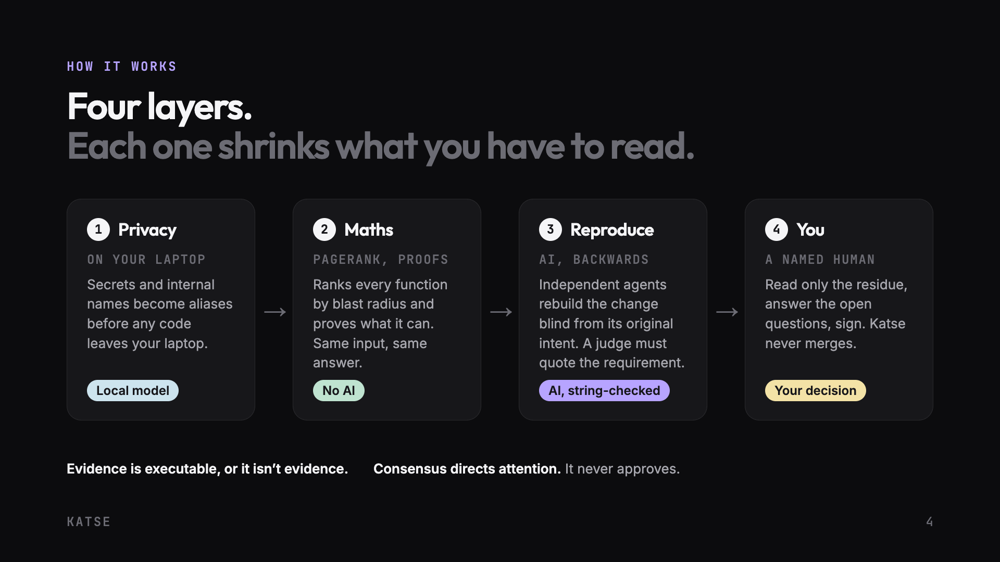

<p align="center"></p>

<h1 align="center">Don't read the change. Reproduce it.</h1>

<p align="center"><b>Katse</b> lets a named human sign every AI-written change without reading every line.<br>
Junction 2026 · Tieto challenge <i>Earned Trust in AI Code</i> · MLH <i>Best Use of Entire</i></p>

<p align="center">
<a href="submission/katse-demo.mp4"><b>▶ Demo video (2:44)</b></a> ·
<a href="submission/katse-pitch.pdf"><b>Slides (PDF)</b></a> ·
<a href="CONCEPT_CARD.md"><b>Concept card</b></a> ·
<a href="docs/EVIDENCE.md"><b>Evidence on Tieto #2283</b></a> ·
<a href="docs/MEASUREMENT.md"><b>Measurement</b></a> ·
<a href="docs/LESSONS.md"><b>Lessons log</b></a>
</p>

<p align="center"><a href="submission/katse-demo.mp4"></a></p>

---

## The idea in 30 seconds

AI writes code faster than anyone can read it, so people just press Enter. Asking *another* AI "is this fine?" is just as bad: **"the AI said it was fine"** is exactly what the challenge rules out.

Science doesn't trust a paper because a reviewer read it twice. It trusts it when **another lab reproduces it**. Banks don't re-read every entry. They **reconcile two independent ledgers** and investigate only the mismatch.

**Katse does the same for code.** An agent's change is cheap to produce, so it is cheap to reproduce. Katse rebuilds it independently and compares:

- whatever **reproduces** (or is proved, or passes a test that really bites) is backed by **evidence**;
- whatever **doesn't** is the **residue**, and that is all the named owner reads, questions and signs.

> **AI reviews. A named human stays accountable.** Katse has no approve button and never merges.

## How it works: four layers

<p align="center"></p>

| | Layer | What happens | AI? |
|---|---|---|---|
| **1** | **Privacy** | Gemma 4 runs **on your laptop** and swaps secrets and internal names for aliases before any code reaches the cloud. Fail-closed: if the scan can't finish, nothing is sent. | Local model |
| **2** | **Maths** | Call graph straight from git. **PageRank** sizes each function by blast radius, **proofs** mark edits that can't change behaviour, **deterministic checks** catch leaked keys, deleted tests and silenced errors. 1,307 changed lines become 55 worth reading. | **None** |
| **3** | **Reproduce** | Back to the **intent** (the exact prompt, saved by **Entire** in git, else the issue). Agents from **two model families** rebuild the change **blind**. A difference has to be settled by a judge who **quotes the requirement sentence**, and that quote is checked by plain string search. New tests must go **red→green**, and seeded bugs must be caught. | AI, checked by execution |
| **4** | **You** | Read the residue, answer the open questions, write the risk you accept, **sign**. The signature is bound to the commit and the report hash, and it expires if the branch moves. | **Human** |

**Two rules hold everywhere:** *Evidence is executable, or it isn't evidence.* · *Consensus directs attention. It never approves.*

---

## Where to find each thing Tieto asked for

### What Tieto expects from each team

| # | Expected | Where |
|---|---|---|
| 1 | **Define the concept**: what the "PR review factory" should follow | [CONCEPT_CARD.md §1–2](CONCEPT_CARD.md#1-recommendation) · video 0:12 · slides 3–4 |
| 2 | **Key principles**, balancing risk, hallucination, transparency, confidence and quality | [CONCEPT_CARD.md §3–4](CONCEPT_CARD.md#3-principles) · slide 19 |
| 3 | **One sample agent-written change with its requirement ID** | Tieto branch `ju26-issue-2283` → requirement [#2283](https://github.com/MessagePack-CSharp/MessagePack-CSharp/issues/2283): [docs/EVIDENCE.md](docs/EVIDENCE.md) |
| 4 | **What the AI found, what it refused to decide, and why** | [EVIDENCE.md §2–3](docs/EVIDENCE.md#2-what-the-ai-found-all-of-it-executed) and the [other three branches](docs/EVIDENCE.md#the-other-three-tieto-branches-different-lanes-different-reasons) |
| 5 | **How the evidence lets a named human accept without a full read** | [EVIDENCE.md §5](docs/EVIDENCE.md#5-what-the-human-reads-and-signs): 29 of 228 lines plus 2 questions · video 2:19 · slide 16 |
| 6 | **Failure modes seen + a short decision log** | [docs/LESSONS.md](docs/LESSONS.md) (20 failure modes, including our own reviewer's) · [docs/DECISIONS.md](docs/DECISIONS.md) (44 decisions) |

### Deliverables

| Deliverable | Where |
|---|---|
| **Concept card**: recommendation, principles, trade-offs, limits | [CONCEPT_CARD.md](CONCEPT_CARD.md) |
| **Live walkthrough showing where the trust comes from** | [Demo video](submission/katse-demo.mp4) · [run it yourself](docs/RUNNING.md) · [real review reports](docs/evidence/) |
| **Lessons log + demo video / presentation** | [docs/LESSONS.md](docs/LESSONS.md) · [video](submission/katse-demo.mp4) ([subtitles](submission/katse-demo.srt)) · [slides PDF](submission/katse-pitch.pdf) |

### Judging criteria

| Criterion | What we show | Where |
|---|---|---|
| **Clarity (30%)** | One recommendation (*reproduce, don't read*), 10 principles, explicit trade-offs and limits | [CONCEPT_CARD.md](CONCEPT_CARD.md) · slides 19, 21 |
| **Practicality (25%)** | Works on any git repo (a PR is a branch ahead of its base), three depths with hard time and token budgets, lanes route human attention, a named owner signs, trust per area | [CONCEPT_CARD.md §5](CONCEPT_CARD.md#5-who-owns-the-decision) · [MEASUREMENT.md rollout](docs/MEASUREMENT.md#how-a-team-would-roll-it-out) |
| **Measurement (25%)** | Read ratio, share routed to humans, seeded defects caught, findings acted on, reviewer stability, escapes per area. Safety condition: *review time may only fall while escapes don't rise* | [docs/MEASUREMENT.md](docs/MEASUREMENT.md) · slide 18 |
| **Evidence (20%)** | Requirement-quoted contract, red→green tests, 174/174 regressions, 3/4 seeded bugs, an attack refuted on two model families, open questions, a "not checked" list | [docs/EVIDENCE.md](docs/EVIDENCE.md) · [raw reports](docs/evidence/) · slides 15, 17 |

---

## The sample change: Tieto #2283

**Requirement:** [#2283](https://github.com/MessagePack-CSharp/MessagePack-CSharp/issues/2283), *the generator and analyzer crash with `IndexOutOfRangeException` on a closed generic struct from a referenced assembly.* Agent-written fix: 4 files, 228 lines.

| | |
|---|---|
| ✅ **Found, and executed** | Compiles on the pinned base · 3/3 new tests **red→green** · **174/174** existing tests pass · **3/4** seeded bugs caught · attack refuted on the original **and** on two blind rebuilds (Gemini + NVIDIA Nemotron) · a planted false accusation thrown out by running it |
| ❓ **Refused to decide** | The change **silently drops** some diagnostics (`TypeCollector.cs:1441`, *"they are dropped here"*). The issue never asks for that, so it is a product decision → **a question for the owner**. Also: two regions no rebuild produced (possible overreach) |
| ⛔ **Not checked, and said so** | NativeAOT/trimming, Windows, .NET 10, 7 other test projects, performance, deep security, the original prompt (none saved) |
| ✍️ **The owner reads** | **29 of 228 lines** + 2 questions, writes the risk they accept, signs. The area is on probation (0/5), so a second reviewer audits |

### All four Tieto branches

| Branch | Lines | Outcome | Human reads |
|---|---|---|---|
| [#2283](https://github.com/MessagePack-CSharp/MessagePack-CSharp/issues/2283) crash fix | 228 | *Ready for human approval* + 2 questions | 29 lines |
| [#2297](https://github.com/MessagePack-CSharp/MessagePack-CSharp/issues/2297) attribute in generated code | 1,392 (237 files) | 228 snapshots are the same block, **one differs**; change excluded on two targets → question | **32 lines (2%)** |
| [#2234](https://github.com/MessagePack-CSharp/MessagePack-CSharp/issues/2234) analyzer bug | 266 | **4 of 10 new tests pass without the change**; requirement too vague → *send back* | — |
| [#2129](https://github.com/MessagePack-CSharp/MessagePack-CSharp/issues/2129) new feature | 1,043 | **New public API** → *full read*, ordered by the report | 450 lines |

Katse says **"don't trust this yet"** as readily as "this is fine".

---

## The judges' questions

**What would make you not trust your own output?** Every rebuild coming from one model family · new tests that also pass without the change · seeded bugs surviving outside what the human reads · a sandbox that couldn't build or run · the same commit landing in two lanes · no clear requirement and no saved prompt. Katse lists each of these in the report when it happens. It also happened to us: our "blind" agents once escaped their sandbox, and a text-only judge edited the repo ([Lessons 1–3](docs/LESSONS.md#a-failures-of-the-reviewer-ours)).

**Who owns the decision?** One named engineer. They sign what was checked, what wasn't, and the residual risk they accept. Katse never approves and never merges.

**How would this scale?** Review cost follows *decisions*, not lines: maths narrows the diff in under a second with no model, and rebuilds are sized by `n = min(4, 2 + ⌈log₂ G⌉ + H)` and capped by depth (Quick 90 s / Standard 5 min / Deep 15 min) and a token budget. A Standard review of #2283 took **4 min 29 s and about 40k tokens**. Trust is earned **per area**: after 5 clean sign-offs an area goes residue-only, and one escape withdraws it.

---

## Built with

| | |
|---|---|
| **Gemma 4** (local, oMLX / Ollama) | Privacy gateway on the device |
| **Gemini 4** Hydrogen · Carbon | Contract and blind rebuilds · the judge who must quote |
| **NVIDIA Nemotron 3.5 Super** | Second model family, so agreement isn't one model agreeing with itself |
| **Gemini Decisions** · **Gemini Live** | Attention routing that can only add doubt · voice ("Hey Katse") |
| **Entire** | The AI session behind every commit, saved in git, so the review can walk back to the original prompt |
| **Node.js** (no framework) · **Roslyn** · **.NET 8** | Server and UI with no build step · C# symbol analysis · test execution |

The maths layer (PageRank, proofs, entropy, complexity, checks) has **no model in it**: no model can turn a node green.

## Run it

```bash
npm ci
cp .env.example .env.local    # add your model keys; never commit this file
npm start                     # http://localhost:4173
```

Full guide (privacy, Entire, CLI, API, tests): [docs/RUNNING.md](docs/RUNNING.md).

## Repository map

| Path | What |
|---|---|
| [CONCEPT_CARD.md](CONCEPT_CARD.md) | The concept on one page |
| [submission/](submission/) | Demo video, subtitles, slides PDF |
| [docs/](docs/) | [Evidence](docs/EVIDENCE.md) · [Measurement](docs/MEASUREMENT.md) · [Lessons](docs/LESSONS.md) · [Decisions](docs/DECISIONS.md) · [Running](docs/RUNNING.md) · [raw review reports](docs/evidence/) · [research notes](docs/research/) |
| [server/](server/) | Backend: [math/](server/math/) (no-AI layer), [pipeline/](server/pipeline/) (rebuild, attack, judge, evidence), [privacy.js](server/privacy.js), [ledger.js](server/ledger.js) (trust per area) |
| [mvp/](mvp/) | Web UI: branch tree, dependency graph, review and sign |
| [tools/Katse.Analyze](tools/Katse.Analyze/) | Roslyn helper for C# symbols |
| [scripts/](scripts/) | Setup, health checks, demo cases, Entire helpers |
| [test/](test/) | Katse's own test suite |
| [visual/](visual/) | Brand identity |

## Honesty notes

- **Sample data is public.** The Tieto challenge repo and its public MessagePack issues. No private code.
- **The video's main case is a synthetic demo branch** (`easy/lz4-guards`, created by `npm run demo:cases`) so the idea fits in seconds. Its Entire session is a **seeded fixture**, marked as such in the code. The Tieto branches carry no saved prompts, and their reports say so.
- **The 0–10 rubric is not a probability.** It always shows its four components and is never an approval.
- **What isn't proven yet:** no real merges, so 0 escapes means nothing yet; one early experiment showed no advantage of rebuilding over direct review at the same budget. See [MEASUREMENT.md](docs/MEASUREMENT.md#what-we-cannot-claim-yet).
- Working notes written in Spanish during the hackathon are kept in [docs/archive-es/](docs/archive-es/).
