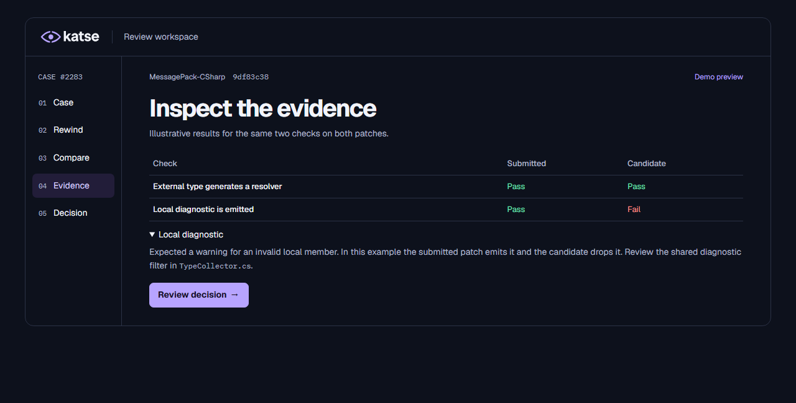

# Katse · UI e identidad

Mockup interactivo de escritorio para el caso **#2283**. Descarga el repo o clónalo y abre [`index.html`](./index.html) en el navegador. Puedes editar el HTML, el CSS y el JS en ese mismo archivo.

El flujo pasa por **Case → Rewind → Compare → Evidence → Decision**. Los resultados son ilustrativos. La decisión de prueba se muestra durante la sesión.

## Identidad

- [Logo completo](./katse-logo.svg) y [ojo para el favicon](./katse-favicon.svg), ambos en SVG transparente.
- Fondo `#0D111C`, paneles `#171D2C`, violeta `#B7A4FF` y texto `#F2F4FA`.
- Geist para la interfaz e IBM Plex Mono para los datos técnicos.

